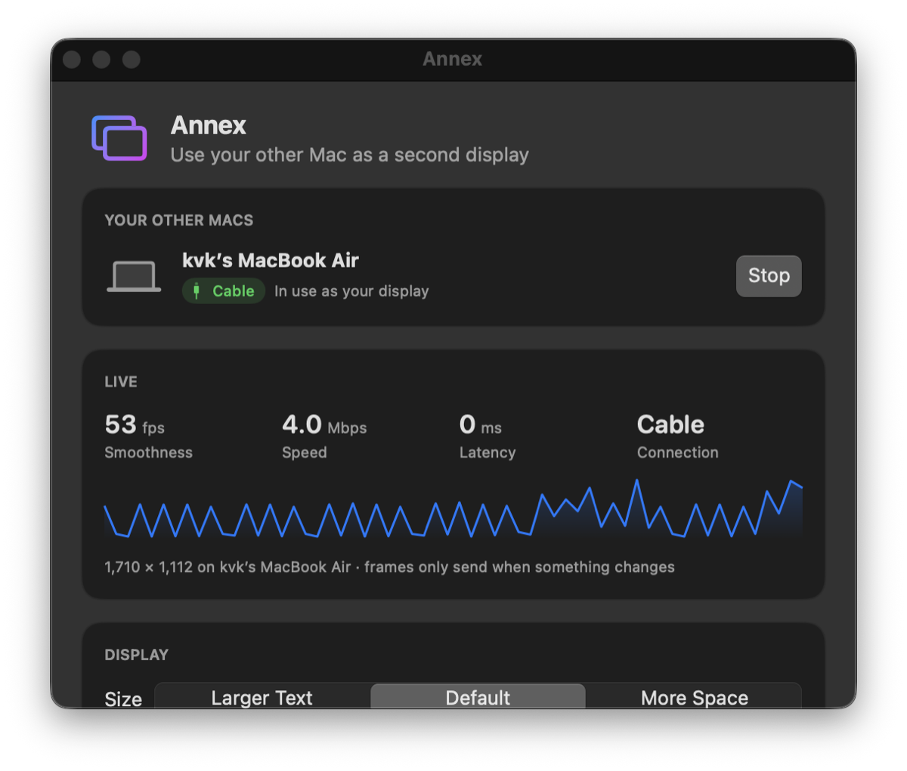

# Annex

🌐 **Website: [annex-mac.vercel.app](https://annex-mac.vercel.app/)**

**Use your other Mac as a second display.** Plug in a cable (or just share Wi-Fi), click once, done.

Annex is for the MacBook sitting in your drawer. Your main Mac gets a real extended display that fills the other Mac's whole screen, notch area included, at its native shape. AirPlay letterboxes it to 16:9.

- **One click.** Open Annex on both Macs → click **Use as Display** → click **Allow**.
- **Full screen, native shape.** The new display matches the other Mac's screen exactly. No black bars.
- **Cable or Wi-Fi, automatically.** Thunderbolt/USB-C when plugged in (≈1 ms), Wi-Fi otherwise, and it switches mid-session.
- **Reconnects by itself.** Sleep, unplug, walk away. It comes back when the other Mac does.
- **Live stats:** frame rate, speed, latency, connection type.
- **Private.** Mac to Mac, nothing leaves your desk. No account.

**[⬇ Download Annex](https://github.com/kvksatish/annex/releases/latest/download/Annex.dmg)** · [Website](https://annex-mac.vercel.app/) · [User manual](docs/USER_MANUAL.md)



## How it works

```
Your Mac                                              Other Mac
virtual display → ScreenCaptureKit → H.264 (hardware) ──TCP──▶ hardware decode → full-screen window
                                            ▲                       │
                                            └──── ping/pong (latency, liveness) ┘
```

- **Virtual display:** macOS's `CGVirtualDisplay` (private API, also used by DeskPad and BetterDisplay), sized to the receiver's screen.
- **Capture:** ScreenCaptureKit, only when pixels change.
- **Encode/decode:** VideoToolbox H.264 with low-latency rate control; `AVSampleBufferDisplayLayer` shows frames immediately.
- **Discovery:** Bonjour `_annex._tcp`. Each Mac also announces its Thunderbolt-bridge addresses so the cable is always preferred.
- **Pairing:** the first connection from a Mac must be allowed on the receiving Mac; it's remembered after that.

## Releasing

```sh
./scripts/package.sh                                   # → build/Annex.dmg
gh release create vX.Y.Z build/Annex.dmg --title "Annex X.Y.Z" --notes "…"
```

The website's download button always points at the newest release's `Annex.dmg`.

## Open core

The app and engine here are MIT open source. **Official downloads** use the Haze design (fonts, colours and glass from a private design system); they're built from this exact source plus a private theme folder.

Building from source gives the standard look (`src/app/Theme/Theme.swift`). Every colour, font and surface goes through that one file, so you can make your own theme: copy it, change it, and build with `ANNEX_THEME_DIR=path/to/your/theme ./scripts/build.sh`. An optional `Fonts/` folder next to it gets bundled.

## Build from source

Requires Xcode Command Line Tools (`xcode-select --install`). No Xcode project needed.

```sh
./scripts/build.sh            # → build/Annex.app
open build/Annex.app
```

`scripts/deploy-dev.sh user@other-mac` builds and installs on both Macs over SSH for quick testing.

```
src/engine/   Objective-C: protocol, sender (capture + encode), receiver (decode + full-screen window)
src/app/      SwiftUI: dashboard, menu bar, discovery, activity log
scripts/      build, icon, dev deploy
docs/         user manual
```

## Status

Early but working. Tested on a MacBook Pro (M4 Pro, macOS 26) extending to a MacBook Air (M4, macOS 15) over Thunderbolt and Wi-Fi.

Known gaps:
- Builds are not yet signed/notarized, so the first launch needs *Open Anyway*.
- One extra display at a time.
- No audio, and the other Mac's own keyboard/trackpad doesn't control the extended display. Use your main Mac's.

## Contributing & bugs

Found a problem? In Annex, open **Activity → Report a Problem…**. It pre-fills an issue with your macOS version and log. PRs welcome.

## License

MIT. See [LICENSE](LICENSE).
